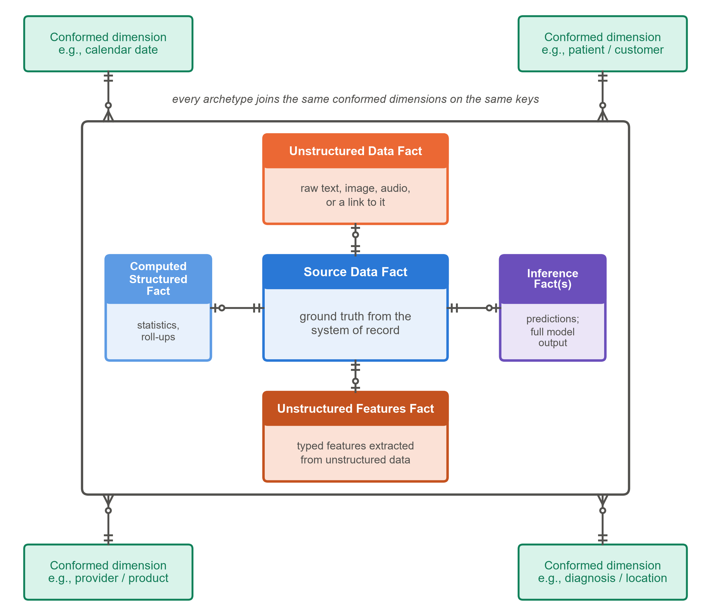
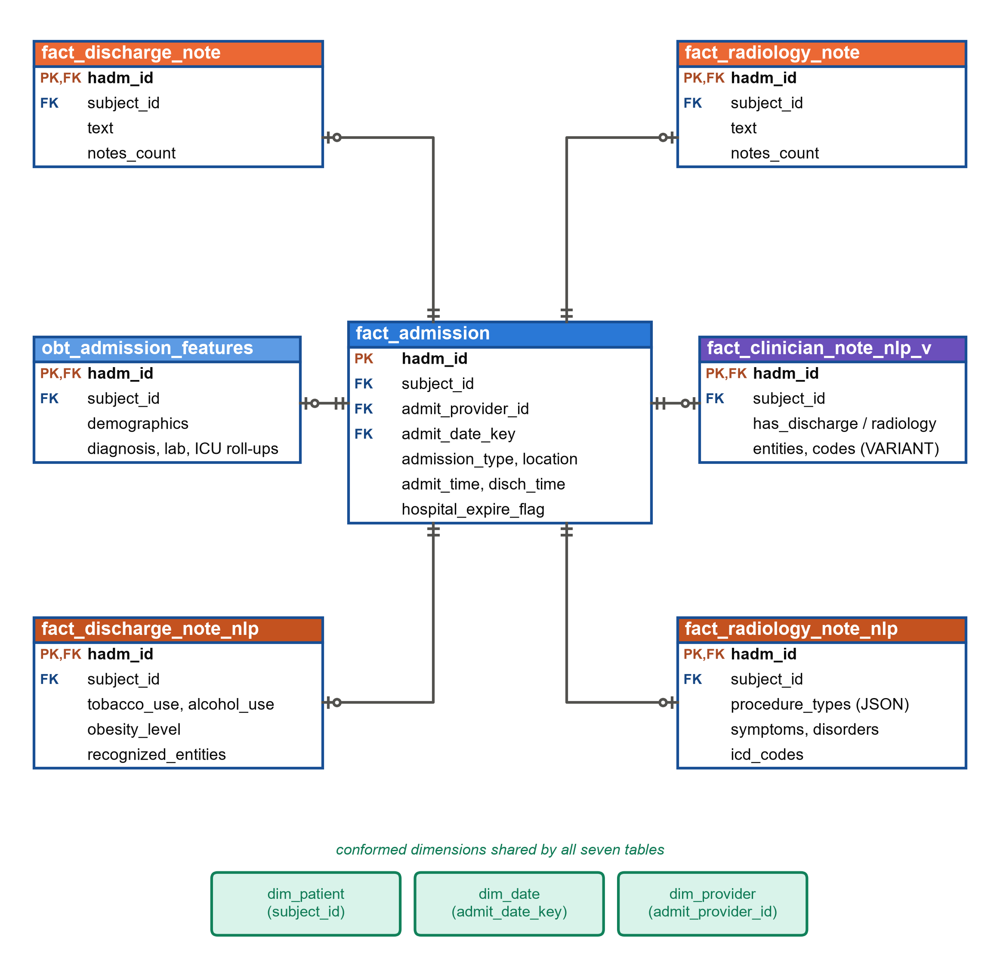
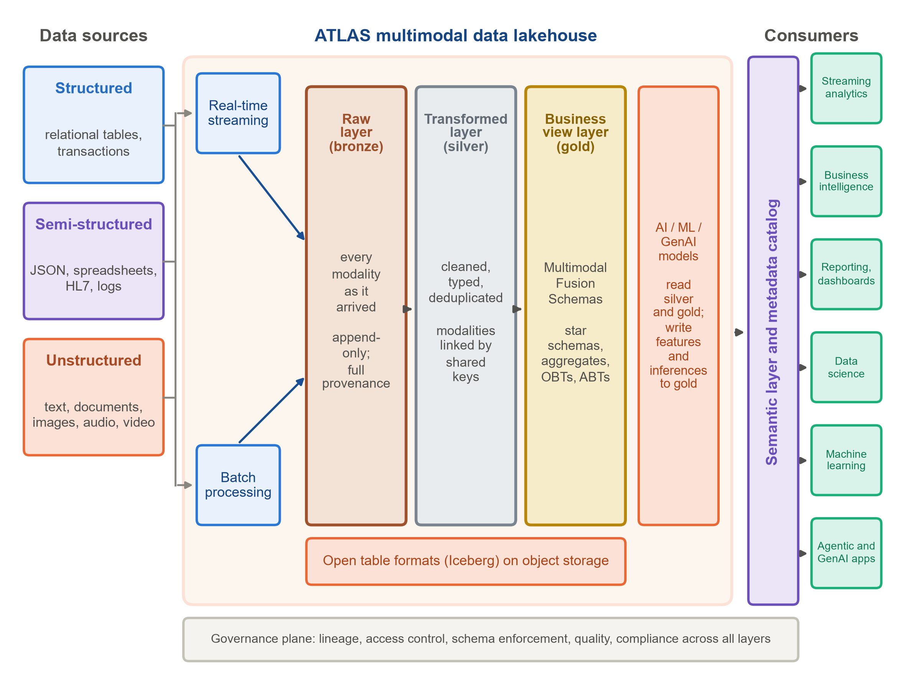

# MIMIC-IV Lakehouse

**A research codebase and the reference implementation of the ATLAS multimodal data
lakehouse, built on the Multimodal Fusion Schema, using the MIMIC-IV hospital database.**

## About this repository

This repository accompanies the book *End-to-End Data Architecture for Multimodal Data:
A Practitioner's Guide to the ATLAS Multimodal Data Lake Framework for AI-Ready Enterprise
Platforms* (research edition) and its trade edition, *Multimodal Data Architecture for
Intelligent Enterprise*, by Narendra Prabhakarrao Nagtode. The book is based on the author's
doctoral research at Golden Gate University, which introduced the **Multimodal Fusion
Schema** and the **ATLAS** multimodal lakehouse architecture.

It is a **research codebase**. It contains everything needed to build the reference
implementation end to end on AWS, run it, and reproduce the measurements reported in the book:
storage footprint, query coverage, join performance, incremental refresh, time to insight, and
cost. It is not a production product. The code favors transparency and reproducibility, and
every design choice is explained in the book (Chapters 6, 9, 11, and 12, and Appendix 8).

The data comes from two de-identified clinical datasets on PhysioNet: **MIMIC-IV 3.1**
(546,028 hospital admissions) and **MIMIC-IV-Note 2.2** (331,794 discharge summaries and
2,321,355 radiology reports). Both require credentialed access under the PhysioNet data use
agreement, so **no MIMIC data is included in this repository**. The pipeline also runs on the
openly available MIMIC-IV demo dataset (`--dataset demodataset`).

A companion repository, `mimiciv_datawarehouse_repo`, builds the same data as a traditional
star-schema data warehouse on Amazon Aurora PostgreSQL. It is the baseline that ATLAS is
compared against.

## The Multimodal Fusion Schema

Organizations usually keep their structured records in a warehouse and their text, images,
and AI model outputs in separate stores. Questions that need both therefore become
integration projects. The Multimodal Fusion Schema extends Kimball's star schema so that every
kind of data, and every AI output derived from it, is stored as a fact at a declared grain on
the **same keys and conformed dimensions** as the business records. A cross-modal question
then becomes an ordinary SQL query.

The schema defines five fact archetypes:

| Archetype | What it holds | In this repository |
|---|---|---|
| **Source Data Fact** | Ground truth from the system of record | `fact_admission` and the other source facts |
| **Computed Structured Fact** | Statistics and roll-ups computed deterministically from source facts | incremental aggregates and OBTs such as `obt_admission_features` |
| **Unstructured Data Fact** | The raw content (text, image, audio) or a link to it | `fact_discharge_note`, `fact_radiology_note` |
| **Unstructured Features Fact** | Stable, typed features extracted from unstructured data | `fact_discharge_note_nlp`, `fact_radiology_note_nlp` (medSpaCy) |
| **Inference Fact** | Model output kept as the model returned it, with provenance | `fact_clinician_note_nlp_v` (Iceberg format-version-3 `VARIANT`) |

The first two are ordinary star-schema patterns, named here to complete the taxonomy. The
last three are where the schema does new work. A simple test separates the last two:
stable, typed columns are features, and output kept as the model returned it is an inference.



*The Multimodal Fusion Schema: every archetype joins the same conformed dimensions on the same keys.*



*The schema as built here for hospital admissions: all seven tables share the admission key
(`hadm_id`) and the conformed patient, date, and provider dimensions.*

## The ATLAS architecture

ATLAS (Adaptive Tiered Lakehouse for Aligned Semantics) is a multimodal data lakehouse that
embeds the Multimodal Fusion Schema in a medallion architecture on open table formats.

- **Raw layer (bronze).** Every modality is landed exactly as it arrived, append-only, with full provenance.
- **Transformed layer (silver).** Data is cleaned, typed, and deduplicated, and modalities are linked for the first time through shared identifiers.
- **Business view layer (gold).** The Multimodal Fusion Schemas, conventional star schemas, aggregates, one big tables (OBTs), and analytical base tables (ABTs) live here, in open table formats on object storage.
- **AI, ML, and GenAI models.** Models read silver and gold, and write their features and inferences back to gold as facts, on the same keys as the records they describe.
- **Semantic layer and metadata catalog.** One governed interface for BI, reporting, data science, machine learning, and agentic applications.
- **Governance plane.** Lineage, access control, schema enforcement, quality, and compliance span every layer.



*The ATLAS multimodal data lakehouse architecture.*

In this reference implementation, the layers map onto AWS serverless services:
- **Storage:** Amazon S3 for storage.
- **Catalog:** AWS Glue crawlers and the Glue Data Catalog.
- **Transformation:** AWS Glue (Spark and Visual ETL) jobs.
- **Gold layer:** Apache Iceberg tables.
- **Query engine:** Amazon Athena.
- **Language processing:** rule-based medSpaCy pipelines that write the features and the Inference Fact.

The implementation serves SQL users through Athena; it does not build streaming ingestion.

### What the reference implementation showed

Measured against the companion data warehouse (details in the book, Chapters 6, 8, 9, 10, and 11):

- **Workflow coverage:** all 30 executable analytical workflows were answerable with the Multimodal Fusion Schema, against 86.67% without its multimodal archetypes.
- **Ad hoc coverage:** 97.8% of ad hoc questions combining structured data with AI output were answerable, against 7.8% for the warehouse.
- **Joins:** joins processed in place ran about 2.5 times faster than the decoupled approach.
- **Incremental refresh:** re-runs were a geometric mean of 2.82 times faster than the initial builds.

## Book companion tools

Readers of the book can also use:

- **Runnable examples ([book_companion/](book_companion/README.md)), on synthetic data with no AWS account needed:**
  - **Chapter 17:** an analytics agent over the lakehouse, with an MCP server, a framework-free agent loop, a Claude Agent SDK version, an Agent Skill, and a test that needs no API key.
  - **Chapter 20:** ten SQL data-quality rules and a write–audit–publish gate.
- **Spreadsheet companions, distributed with the book's companion materials (not in this repository):**
  - the TCO calculator
  - the business-case template
  - the governance and quality scorecard
  - the implementation roadmap planner
- **Build guides:** step-by-step instructions for building this lakehouse and the comparison warehouse are in Appendices 8 and 9 of the research edition.

## What the pipeline does

An end-to-end **data-lakehouse** pipeline for MIMIC-IV on AWS: raw CSVs → S3 → a Glue
crawler catalogs a bronze layer → Glue Studio Visual ETL / Spark jobs load an **Apache
Iceberg** gold layer (dimensions, facts, incremental aggregates, three OBTs) → optional
NLP jobs derive fact tables from the free-text notes (MIMIC-IV-Note). Everything is
queryable from Athena over one shared Glue Data Catalog.

- **Run it all with one command:** [`python run_lakehouse_pipeline.py`](#run-the-whole-pipeline-one-command)
- **Two datasets, fully isolated:** [`--dataset {demodataset,fulldataset}`](#choosing-the-dataset---dataset)
- Sibling repo `mimiciv_datawarehouse_repo` builds the same data as a classic Aurora
  PostgreSQL star schema, for the lakehouse-vs-warehouse comparison.

## Project layout

- [book_companion/](book_companion/README.md) — runnable examples from the book on synthetic data: the Chapter 17 lakehouse agent (MCP server, `agent.py`, Claude Agent SDK version, Agent Skill, no-API-key plumbing test) and the Chapter 20 data-quality rules with a write–audit–publish gate
- `data/raw/` — all local raw source data (git-ignored). `mimic-iv-clinical-database-demo-2.2/` (the demo dataset: `hosp/`, `icu/`, `notes/`, `subject/`) is used for `--dataset demodataset` (the default); `mimic-iv-3.1-fulldataset/` (~19 GB) for `--dataset fulldataset`. See [Choosing the dataset](#choosing-the-dataset---dataset).
- [run_lakehouse_pipeline.py](run_lakehouse_pipeline.py) — one-command end-to-end driver: setup → create every Glue job → run them in dependency order, waiting between phases. `--dataset`, `--with-nlp`, `--row-limit N` (fact-table cap), `--nlp-row-limit N` (NLP note cap, default 10000, independent of `--row-limit`), `--with-format-compare` (phase K, Iceberg vs Parquet vs CSV), `--with-compaction` (Athena `OPTIMIZE` plus phase L, Glue compaction of the format-v3 VARIANT table), `--from <PHASE>`, `--dry-run`. Logs every job's start/end/duration to `etl_process_log` for timing analysis (`--no-process-log` to disable)
- [setup_mimic4_s3_glue.py](setup_mimic4_s3_glue.py) — compatibility entry point
- [src/mimic_lakehouse/aws_workflow.py](src/mimic_lakehouse/aws_workflow.py) — AWS orchestration logic
- [src/mimic_lakehouse/cli.py](src/mimic_lakehouse/cli.py) — command-line interface
- [ddl/gold](ddl/gold) — Athena/Glue gold-layer DDL scripts
- [ddl/extract_raw_ddl.py](ddl/extract_raw_ddl.py) — export Glue table DDL from the raw database into SQL
- [etl/create_dim_visual_etl_jobs.py](etl/create_dim_visual_etl_jobs.py) — creates AWS Glue Studio Visual ETL jobs that load each raw-sourced Gold dimension table
- [etl/create_fact_visual_etl_jobs.py](etl/create_fact_visual_etl_jobs.py) — creates AWS Glue Studio Visual ETL jobs that load each raw-sourced Gold fact/bridge table
- [etl/create_agg_visual_etl_jobs.py](etl/create_agg_visual_etl_jobs.py) — creates AWS Glue Studio Visual ETL jobs that incrementally refresh each Gold aggregate/summary table
- [run_notes_ingest.py](run_notes_ingest.py) → [etl/create_notes_ingest_job.py](etl/create_notes_ingest_job.py) / [notes_ingest.py](notes_ingest.py) — converts the MIMIC-IV-Note CSVs (which can't be crawled) to Parquet raw tables via a `multiLine` Spark reader
- [run_medspacy_nlp.py](run_medspacy_nlp.py) → [etl/create_medspacy_nlp_job.py](etl/create_medspacy_nlp_job.py) / [medspacy_nlp.py](medspacy_nlp.py) — discharge-note NLP via medSpaCy (rule-based, local), loads `fact_discharge_note_nlp` (10,000-note cap by default; see `--nlp-row-limit`)
- [run_radiology_nlp.py](run_radiology_nlp.py) → [etl/create_radiology_nlp_job.py](etl/create_radiology_nlp_job.py) / [radiology_nlp.py](radiology_nlp.py) — radiology-note NLP (section parsing + medSpaCy), loads `fact_radiology_note_nlp` (JSON-in-STRING, Athena-queryable)
- [etl/create_fact_note_concat_job.py](etl/create_fact_note_concat_job.py) / [fact_note_concat.py](fact_note_concat.py) — rolls `discharge_note_raw` / `radiology_note_raw` up from `note_id` grain to admission grain, loading `fact_discharge_note` / `fact_radiology_note` (the Unstructured Data Fact archetype)
- [run_clinician_note_variant.py](run_clinician_note_variant.py) → [etl/create_clinician_note_variant_job.py](etl/create_clinician_note_variant_job.py) / [clinician_note_nlp_variant.py](clinician_note_nlp_variant.py) — Glue 6.0 job that combines `fact_discharge_note_nlp` and `fact_radiology_note_nlp` into one admission-grain Inference Fact, `fact_clinician_note_nlp_v`, with real Iceberg `VARIANT` columns (Spark-only; Athena SQL can't read format-v3). It replaced the earlier radiology-only `fact_radiology_note_nlp_v` (and its `radiology_nlp_variant.py` job), which has been retired
- [src/mimic_lakehouse/config.py](src/mimic_lakehouse/config.py) — minimal `.env` loader, `DatasetProfile` (per-`--dataset` bucket / catalog / role / crawler names), and the `Project=LAKEHSE` cost-allocation tag helpers; see [.env.example](.env.example), [Choosing the dataset](#choosing-the-dataset---dataset), [AWS resource tagging](#aws-resource-tagging)
- [measure_storage_footprint.py](measure_storage_footprint.py) — read-only audit tool: measures physical (S3) and live-snapshot (Athena `$files`) storage per bucket/table, splits structured vs unstructured/NLP, and (with `--aurora-baseline`) renders the data-warehouse vs data-lakehouse comparison. Writes a timestamped JSON + Markdown report to `docs/storage_footprint/<demo|full>/`. See [docs/storage_footprint_analysis.md](docs/storage_footprint_analysis.md) for the P3/P4 framing and method.
- [compact_gold_tables.py](compact_gold_tables.py) / [ddl/maintenance/optimize_gold_tables.sql](ddl/maintenance/optimize_gold_tables.sql) — `OPTIMIZE … REWRITE DATA USING BIN_PACK` (+ optional `VACUUM`) for every Iceberg table in the `--dataset`'s gold database (`mimic4_db_business_<demo|full>`), to undo the small-file fragmentation before a P3 measurement. `--dry-run`, `--only`, `--vacuum --vacuum-max-age`, `--measure`.
- [measure_aws_resources.py](measure_aws_resources.py) — read-only inventory + on-demand cost model for every AWS resource the pipeline uses end-to-end (Glue jobs/DPU-seconds, crawler, Glue Data Catalog, Athena `DataScannedInBytes`, CloudWatch Logs, IAM roles) plus the S3 figures from `measure_storage_footprint.py`. Splits cost into one-time build/debug, one clean rebuild, and steady-state monthly. Writes `docs/cost/<demo|full>/aws_resources_<UTC>.{json,md}`; the lakehouse counterpart to the data-warehouse repo's "Aurora Pipeline Manifest". `--by-run` reads `etl_process_log` instead: detailed resource/timing data per `full_run_id` plus mean/median/stdev across every run found, written to `docs/cost/<demo|full>/runs_<UTC>.{json,md}`.
- [measure_time_to_insight.py](measure_time_to_insight.py) / [docs/tti/render_probe.html](docs/tti/render_probe.html) — P6 time-to-insight test: runs a 19-query battery (structured, joins, event-fact scans, structured×NLP, cross-modal JSON) through Athena over the Gold catalog, captures the per-phase timing (queue/planning/engine/service + client fetch), buckets each into Nielsen's response-time bands (<1 s flow / 1–10 s attention / >10 s lost), cold (reuse off) + warm (reuse on) passes. `render_probe.html` measures the browser chart-render step. Writes `docs/tti/<demo|full>/tti_<UTC>.{json,md}`. Result: 100 % of insights in the 1–10 s band cold, 100 % <1 s warm.
- [measure_native_vs_external_join.py](measure_native_vs_external_join.py) — P5: a 3-way join + aggregate run **native** (one Athena query over Iceberg) vs **externalized** (Athena `UNLOAD` → download → DuckDB join). Reports wall-clock, throughput, and $ cost, ≥10 reps. Needs `pip install -e .[benchmark]` (duckdb + pyarrow). Result: native ~3.5× faster end to end — the whole penalty is the extract hop, not the engine. Writes `docs/p5/<demo|full>/`.
- **RQ1 (storage-format comparison)** — [ddl/gold/mimic_iv_ddl_parquet_comparison.sql](ddl/gold/mimic_iv_ddl_parquet_comparison.sql) / [mimic_iv_ddl_parquet_snappy_comparison.sql](ddl/gold/mimic_iv_ddl_parquet_snappy_comparison.sql) / [mimic_iv_ddl_csv_comparison.sql](ddl/gold/mimic_iv_ddl_csv_comparison.sql) declare one Parquet(ZSTD), one Parquet(Snappy), and one gzip-CSV external table per Multimodal Fusion Schema archetype, column-for-column identical to their Iceberg Gold-table counterpart. [run_parquet_comparison_load.py](run_parquet_comparison_load.py) → [etl/create_parquet_comparison_job.py](etl/create_parquet_comparison_job.py) / [parquet_comparison_load.py](parquet_comparison_load.py), [run_parquet_snappy_comparison_load.py](run_parquet_snappy_comparison_load.py) → [etl/create_parquet_snappy_comparison_job.py](etl/create_parquet_snappy_comparison_job.py) / [parquet_snappy_comparison_load.py](parquet_snappy_comparison_load.py), and [run_csv_comparison_load.py](run_csv_comparison_load.py) → [etl/create_csv_comparison_job.py](etl/create_csv_comparison_job.py) / [csv_comparison_load.py](csv_comparison_load.py) are the three Glue-6.0 copy jobs that populate them from the Iceberg source, unmodified. [measure_parquet_comparison.py](measure_parquet_comparison.py) measures raw physical/live-snapshot bytes and row counts for all four format/codec combinations across all 7 archetypes; [compare_parquet_iceberg.py](compare_parquet_iceberg.py) reads that output and computes the format-vs-codec-isolated ratios. Writes `docs/parquet_comparison/<demo|full>/latest_comparison.{json,md}`. See [Research paper: RQ1 and RQ2](#research-paper-rq1-and-rq2).
- [run_clinician_note_variant.py](run_clinician_note_variant.py) → [etl/create_clinician_note_variant_job.py](etl/create_clinician_note_variant_job.py) / [clinician_note_nlp_variant.py](clinician_note_nlp_variant.py) — the paper's **Inference Fact** archetype instance: full outer join of `fact_discharge_note_nlp` and `fact_radiology_note_nlp` into one admission-grain row, with every JSON-shaped column typed as Iceberg format-version-3 `VARIANT` instead of `STRING`. Requires Glue 6.0 (the only runtime with a Spark `VariantType`); Athena cannot read the resulting table at all (format-version-3 is unsupported).
- [docs/query_coverage/README.md](docs/query_coverage/README.md) — **RQ2**: the thirty-workflow query-coverage catalog and methodology behind the paper's "100% vs 86.67%" schema-coverage result. See [Research paper: RQ1 and RQ2](#research-paper-rq1-and-rq2).
- [compare_environments.py](compare_environments.py) — merges this repo's and `mimiciv_datawarehouse_repo`'s measurement reports into one **P1–P9 proposition scorecard** (`docs/comparison/<demo|full>/comparison_<UTC>.{json,md}`); takes `--dataset`. `--run` re-measures both sides first. The consolidated deliverable is `atlas_lakehouse_vs_warehouse.docx`.
- [run_measurement_suite.py](run_measurement_suite.py) — one-command driver for the whole P1–P7 measurement/comparison suite on both repos: checks no Glue job is currently running for the `--dataset` first, then runs every script in dependency order, streaming + logging each step to `logs/<job_name>_<timestamp>.log`. `--only`, `--stop-on-failure`, `--force`. See [docs/measurement_readme.md](docs/measurement_readme.md).
- [docs/measurement_readme.md](docs/measurement_readme.md) — the runbook: what each measurement script supports and writes, plus the manual step-by-step command sequence `run_measurement_suite.py` automates
- [docs/lessons_learned_glue_iceberg_performance.md](docs/lessons_learned_glue_iceberg_performance.md) — performance lessons from building this pipeline: indexes (there aren't any), sort-merge vs. broadcast joins, over-partitioning, and long ETL execution time
- [docs/fact_and_aggregate_grain_summary.md](docs/fact_and_aggregate_grain_summary.md) ([.csv](docs/fact_and_aggregate_grain_summary.csv)) — grain and uniqueness key for every fact, aggregate, and OBT table in the Gold layer
- [cleanup_mimic4_environment.py](cleanup_mimic4_environment.py) — drops every AWS object this project creates (Glue databases/tables/jobs/crawlers/classifiers, IAM roles), empties the S3 buckets (`--delete-buckets` to remove the shells too), and `--delete-log-groups` for the `/aws-glue/*` CloudWatch groups. `--dataset`; `--resource-suffix ""` targets a pre-naming-change deployment. See [Full environment cleanup](#full-environment-cleanup)

## Research paper: RQ1 and RQ2

This repo is the reference implementation behind *The Multimodal Fusion Schema: Extending
the Star Schema with an Inference Fact Pattern for AI-Native Analytics*, which extends
Kimball's star schema with three multimodal fact archetypes — Unstructured Data Fact,
Unstructured Features Fact, and Inference Fact — built out above (`fact_discharge_note` /
`fact_radiology_note`, `fact_discharge_note_nlp` / `fact_radiology_note_nlp`, and
`fact_clinician_note_nlp_v` respectively) alongside the ordinary Source Data Fact / Computed
Structured Fact tables. The paper asks two empirical research questions about this schema.

**RQ1 — storage efficiency.** *To what extent, if any, does the Apache Iceberg open table
format yield measurable storage efficiency relative to a raw (CSV) table format and the
Apache Parquet table format, when all three are populated with the same multimodal fact
archetypes at an identical grain?*

Answered by a controlled 4-way physical-storage comparison — Iceberg (ZSTD), Parquet
(ZSTD), Parquet (Snappy), and gzip-compressed CSV — across all 7 fact archetypes, isolating
table format from compression codec (Parquet appears in both codecs so the two variables
can be separated). Scripts: the three comparison DDLs, their three Glue-6.0 load jobs, and
`measure_parquet_comparison.py` → `compare_parquet_iceberg.py` (see the RQ1 bullet under
[Project layout](#project-layout) for the full chain and `docs/parquet_comparison/`).
Headline finding: once compression codec is held constant, Iceberg has no aggregate storage
advantage over Parquet — it is 3.5% *larger* — while switching only the codec (ZSTD vs.
Snappy) moves aggregate storage by 43.8%, a larger swing than switching only the format.
The uncontrolled, differently-compressed comparison a naive reading would make therefore
substantially misattributes a codec effect to table format.

**RQ2 — query coverage.** *Does the Multimodal Fusion Schema increase the proportion of
realistic analytical workflows spanning structured and unstructured clinical data that can
be answered without an extract-transform-load detour, relative to a base dimensional model
that lacks its multimodal fact archetypes?*

Answered by scoring a thirty-workflow catalog — spanning encounter/administrative
reporting, diagnosis/procedure/billing, lab/microbiology diagnostics, medications, care
logistics, ICU monitoring, and notes/NLP-derived analysis — against the full Multimodal
Fusion Schema and against an otherwise-identical base dimensional model missing the
Unstructured Data Fact, Unstructured Features Fact, and Inference Fact archetypes. See
[docs/query_coverage/README.md](docs/query_coverage/README.md) for the methodology and the
four cross-modal workflows the comparison turns on. Headline finding: the full schema
answers all 30 workflows end to end (100%); the base dimensional model fully supports the
26 purely-structured workflows but only partially supports the 4 that need a structured
fact joined to a note-derived feature or inference payload, for 86.67% (26 of 30) coverage.

## Setup

```bash
python -m pip install -e .
```

## AWS CLI setup (first time)

If you have not used AWS from this machine before, configure the AWS CLI and enter your credentials once:

```bash
aws configure
```

You will be prompted for:
- AWS Access Key ID
- AWS Secret Access Key
- Default region name — use the same one throughout (this project was built in `us-east-2`; also settable as `AWS_REGION` in `.env`)
- Default output format (for example `json`)

You can also verify that your credentials are working:

```bash
aws sts get-caller-identity
```

The measurement scripts run Athena queries in the workgroup named by `ATHENA_WORKGROUP` in `.env` (default `mimic4-lakehouse`). No script creates it, so either create it once (Athena console → Workgroups, with a query-result location in one of your buckets) or set `ATHENA_WORKGROUP=primary`.

If the command succeeds, your AWS client is configured correctly and the workflow can use it.

## Choosing the dataset (`--dataset`)

Every load / ETL / measurement / cleanup driver takes `--dataset {demodataset,fulldataset}`
(default `demodataset`, overridable with `DATASET=` in `.env`). The choice resolves — via
`DatasetProfile` in [src/mimic_lakehouse/config.py](src/mimic_lakehouse/config.py) — to a
fully isolated set of resource names, so the two datasets can be built and measured side by
side without colliding:

| | `demodataset` | `fulldataset` |
|---|---|---|
| local raw CSVs | `data/raw/mimic-iv-clinical-database-demo-2.2/` | `data/raw/mimic-iv-3.1-fulldataset/` (~19 GB) |
| raw / landing S3 bucket | `mimic4-datalake-v3-2-demo` | `mimic4-datalake-v3-2-full` |
| Iceberg gold S3 bucket | `mimic4-lakehouse-v3-2-demo` | `mimic4-lakehouse-v3-2-full` |
| raw Glue catalog DB (bronze) | `mimic4_db_raw_demo` | `mimic4_db_raw_full` |
| gold Glue catalog DB (business) | `mimic4_db_business_demo` | `mimic4_db_business_full` |
| NLP bucket | `mimic4-nlp-v3-2-demo` | `mimic4-nlp-v3-2-full` |
| Glue crawler | `mimic4-data-v3-2-crawler-demo` | `mimic4-data-v3-2-crawler-full` |
| Glue jobs | `…-demo` (e.g. `dim-load-dim_patient-demo`) | `…-full` |
| IAM roles | `MimicGlue*Role-demo` | `MimicGlue*Role-full` |
| measurement outputs | `docs/<area>/demo/…` | `docs/<area>/full/…` |

Shared between datasets: the Glue scripts bucket (`mimic4-glue-scripts-v3-2-bucket`) and the
format-only CSV classifier (`mimic4_csv_classifier`). The raw S3 upload is idempotent — a
file already present at the same size is skipped — so re-running a load is cheap.

Every explicit flag in the examples below (`--bucket`, `--database`, `--gold-bucket`, …) is
optional: pass `--dataset` alone and the value comes from the profile; pass an explicit flag
to override just that one. To load the full dataset end to end, add `--dataset fulldataset`
to each command in the runbook.

### AWS resource tagging

Every AWS resource this repo provisions — S3 buckets, IAM roles, Glue jobs, the crawler —
is tagged **`Project=LAKEHSE`** on creation (override with `PROJECT_TAG` in `.env`). The
data-warehouse repo tags its resources `Project=DWHS`. Activate the `Project` key under
**Billing → Cost allocation tags** to break spend out by repo in Cost Explorer. Glue
*databases*, *classifiers* and *catalog tables* are not taggable in AWS, so those carry no
tag; everything with a per-resource cost does.

## Run the whole pipeline (one command)

[run_lakehouse_pipeline.py](run_lakehouse_pipeline.py) does every step below in order — setup (buckets, upload,
crawler, Gold DDL), creates all the Glue job definitions, then runs them in dependency
order, **waiting** for each Glue job to finish before starting the ones that depend on it
(`fact_icu_stay_accumulating` after `fact_admission`; `agg_admission_monthly` after
`agg_admission_daily`; the OBTs after their sources).

```bash
# Do not remove the next 2 lines
LOGFILE="logs/run_lakehouse_end_to_end_$(date +%Y%m%d_%H%M%S).log"

python run_lakehouse_pipeline.py --dataset fulldataset --fresh-reload --with-nlp --row-limit 1000000 --nlp-row-limit 50000 2>&1 | tee "$LOGFILE"

python run_lakehouse_pipeline.py                          # demo dataset, structured tables only
python run_lakehouse_pipeline.py --dataset fulldataset     # full dataset, every fact loaded in full
python run_lakehouse_pipeline.py --dataset fulldataset --with-nlp --row-limit 1000000 --nlp-row-limit 50000
                                                          # full dataset, 1M cap on every fact table,
                                                          # 50,000-note cap on medSpaCy/radiology NLP
python run_lakehouse_pipeline.py --with-nlp                # also notes-ingest + medSpaCy/radiology NLP (10k-note cap)
python run_lakehouse_pipeline.py --dry-run                 # print the phase plan, touch nothing
python run_lakehouse_pipeline.py --skip-setup --skip-create --from D   # resume at phase D after a failure
```

**`--row-limit N`** caps every fact table to a `df.limit(N)` sample of its raw source
(tables already smaller than `N` are untouched) — `--row-limit 1000000` is the standard
1M cap for the full dataset, keeping `chartevents` / `labevents` / `emar` / `*events` at a
million rows instead of hundreds of millions. It does **not** affect NLP.

**`--nlp-row-limit N`** (default `10000`) separately caps the medSpaCy / radiology NLP
note set (`--note-limit` on those job creators), kept independent of `--row-limit`:
medSpaCy tags notes one at a time (~1-1.5s/note observed on 2×G.1X), so a fact-table-scale
cap like 1,000,000 notes would take far longer than a single Glue job Timeout. Pass
`--nlp-row-limit 0` to process every note (`--all-notes`). Repeat both flags on any
resumed run that re-creates the job definitions (i.e. without `--skip-create`).

**Forcing a full (non-incremental) reload.** The dim/fact jobs always fully reload every
run — no flag needed. The agg/OBT jobs and (with `--with-nlp`) the NLP jobs are
**incremental by default** via the `<gold_database>.etl_control` watermark, and neither
those job creators nor `run_lakehouse_pipeline.py` expose a `--refresh-mode` flag to force
them past it. The one clean way to force a true full reload of everything is to clear
`etl_control` first, so every watermark-based job sees "no watermark" and runs its
full-backfill path — the same code path a first-ever run takes:

```bash
# 1. Clear the watermark table so agg/OBT (and NLP, if included) treat this as a fresh backfill
aws athena start-query-execution \
  --query-string "DELETE FROM mimic4_db_business_full.etl_control" \
  --query-execution-context Database=mimic4_db_business_full \
  --result-configuration OutputLocation=s3://mimic4-glue-scripts-v3-2-bucket/athena-results/ \
  --region us-east-2

# 2. Run the full pipeline
python run_lakehouse_pipeline.py --dataset fulldataset --row-limit 1000000
```

Add `--with-nlp --nlp-row-limit 50000` (or whatever cap) to the same command to also fully
reprocess the NLP tables — with `etl_control` cleared, they run their `auto` full-backfill
path too, so `--refresh-mode full` isn't needed separately on top of this.

**Worker sizing + concurrency (full dataset).** The dim/fact/agg jobs default to 2 × G.1X,
which OOMs on the multi-100M-row raw tables. `--num-workers` / `--worker-type` /
`--glue-version` set the default for every job; `--big-worker-type` (default `G.2X`) ×
`--big-num-workers` (default 10) apply to the `--big-jobs` list — the fact/OBT jobs that
read `chartevents` / `labevents` / `emar` / `poe` / `prescriptions` / `*events`. Within a
phase the pipeline launches jobs in **DPU-budgeted waves** capped at `--max-dpu` (default
90; the account's hard concurrent-capacity limit is 100 DPU — G.1X = 1 DPU/worker, G.2X =
2). `--only fact_lab_result,fact_chart_observation` restricts a resumed run to specific
jobs (targeted catch-up after a partial failure).

```bash
python run_lakehouse_pipeline.py --dataset fulldataset --max-dpu 90
# resume just two jobs after a failure, then continue:
python run_lakehouse_pipeline.py --dataset fulldataset --from C --only fact_lab_result,fact_chart_observation
python run_lakehouse_pipeline.py --dataset fulldataset --from D
```

**Job timing log.** Every time a Glue job the driver started reaches a terminal state
(`SUCCEEDED`/`FAILED`/`STOPPED`/`TIMEOUT`/`ERROR`), it appends one row to
`<gold_database>.etl_process_log` — `full_run_id`, `run_id`, `job_name`,
`process_name`/`process_type` (parsed from the job name, e.g.
`fact-load-fact_admission-full` → `fact` / `fact_admission`), `phase`, `dataset`,
`start_ts`/`end_ts` (Glue's own `StartedOn`/`CompletedOn`), `execution_seconds` (Glue's
`ExecutionTime`, excludes queue/startup), `dpu_seconds`, `raw_row_count`/`gold_row_count`
(a `COUNT(*)` of the job's source raw table and destination gold table, taken right after
it finishes; `NULL` where not applicable — e.g. aggregates read another gold table, not a
raw one), `status`, and `error_message`. `full_run_id` is one number shared by every row
from the same driver invocation (`MAX(full_run_id) + 1` over the table's existing rows,
so it survives a `--from <PHASE>` resume being a separate invocation) — group by it to see
one end-to-end run's jobs together. Unlike `etl_control` (one current watermark row per
target, overwritten every run), this table is append-only, so a full run history
accumulates — query it in Athena to compare timings across runs (e.g. before/after a
partitioning fix, or demo vs. full scale):

```sql
SELECT process_type, process_name, status, execution_seconds, dpu_seconds,
       raw_row_count, gold_row_count, start_ts
FROM mimic4_db_business_full.etl_process_log
WHERE full_run_id = (SELECT max(full_run_id) FROM mimic4_db_business_full.etl_process_log)
ORDER BY start_ts;
```

Pass `--no-process-log` to disable it. A logging failure (e.g. the table doesn't exist yet
on an older deployment) only prints a warning — it never aborts the pipeline.

Rather than hand-writing SQL against it, `measure_aws_resources.py --by-run` reads this
table for you: one row of detailed data per `full_run_id` (job count, total DPU-seconds,
Glue $ cost, wall-clock time, raw/gold row totals, a breakdown by process type) plus
mean/median/stdev across every run found — useful once you've run the pipeline more than
once (e.g. before/after a partitioning fix, or repeated full-dataset runs) and want to see
whether timings are stable or trending. Writes `docs/cost/<demo|full>/runs_<UTC>.{json,md}`.

Everything is idempotent; on a job failure the script stops and prints the exact
`--from <PHASE>` command to resume. The manual step-by-step below is still available for
running or re-running any single piece.

## Manual step-by-step

`run_lakehouse_pipeline.py` runs all of the below in order. Run the individual steps by
hand when you want to (re-)run one piece, inspect a job's DAG in Glue Studio, or debug.
Every command takes `--dataset` (default `demodataset`); add `--dataset fulldataset` to
each one for the full dataset. `--scripts-bucket`, `--raw-s3-bucket`, `--gold-s3-bucket`,
`--database`, `--crawler-name`, and the role names all default from the `--dataset`
profile — pass one explicitly only to override it.

### 1. Setup: buckets, upload, crawler, Gold DDL

```bash
python setup_mimic4_s3_glue.py --create-role
```

Creates the raw / gold / scripts buckets (`Project=LAKEHSE`-tagged), uploads the local
CSVs (idempotent — same-size files are skipped), creates the crawler IAM role
(`MimicGlueCrawlerRole-demo`) + the `mimic4_csv_classifier`, creates + runs the crawler
(`mimic4-data-v3-2-crawler-demo` → `mimic4_db_raw_demo`), patches a few mis-classified raw
tables, then applies the gold-zone DDL via Athena (`mimic4_db_business_demo`, empty
Iceberg tables).

Flags:
- `--iam-role-arn <arn>` — use an existing crawler role instead of `--create-role`
- `--skip-load` — skip the raw half (bucket, upload, role, crawler); still runs the gold DDL. Use it to re-apply only the Gold DDL against data already loaded.
- `--skip-gold-ddl` — stop after the crawler; don't create the gold tables

The crawler IAM role is granted `AWSGlueServiceRole`, S3 read on the scripts + raw
buckets, and S3 read/write on the gold bucket.

### 2. dim_date (calendar spine)

`dim_date` has no raw CSV source — it's generated by a standalone Glue **script** job
(`dim_date_seed.py`), created and run by:

```bash
python etl/create_dim_date_seed_job.py --create-role --run-now
```

This creates the `dim-date-seed-job-demo` Glue job (role `MimicGlueDimDateSeedRole-demo`)
and starts a run that writes `glue_catalog.mimic4_db_business_demo.dim_date`.
(`run_dim_date_seed.py` only *prints* a standalone PySpark snippet — it does not deploy
anything; use `create_dim_date_seed_job.py` for the real job.)

### 3. Raw-sourced Gold dimensions

Unlike `dim_date`, most Gold dimensions are sourced from a raw crawled table, so each is loaded by its own AWS Glue Studio Visual ETL job (`<raw table>` -> ApplyMapping -> Custom Transform (audit columns) -> `<gold table>`), all generated from one script. The audit columns (`created_ts`, `updated_ts`, `created_by`, `updated_by`) are populated with a Custom Transform node using the PySpark DataFrame API, not a SQL-based transform node.

Create/update and run every dimension job with:

```bash
python run_dim_visual_etl.py --create-role --run-now
```

This loads `etl/create_dim_visual_etl_jobs.py` and creates one job per entry in its `DIMENSIONS` list (`dim_hcpcs`, `dim_diagnosis`, `dim_procedure`, `dim_lab_item`, `dim_patient`, `dim_provider`, `dim_caregiver`, `dim_chart_item`), named `dim-load-<dimension>-<demo|full>`. All jobs share a single IAM role (`MimicGlueDimLoadRole-<demo|full>`). Use `--only dim_diagnosis,dim_procedure` to (re)create a subset. Each job's DAG can be viewed and edited in the AWS Glue Studio console.

`dim_date` is excluded (see above) -- it's a calendar spine with no raw CSV source. `provider_raw` and `caregiver_raw` are single-column CSVs that Glue's built-in CSV classifier doesn't reliably identify (crawled with zero/wrong columns); `aws_workflow.py`'s setup workflow overwrites both with an explicit schema (`overwrite_provider_table()` / `overwrite_caregiver_table()`) after the crawler runs, so `dim_provider` and `dim_caregiver` load correctly.

Each job's Custom Transform writes with Iceberg's native `df.writeTo(...).overwritePartitions()`, not Glue's `write_data_frame.from_catalog(additional_options={"overwrite": "true"})` -- that call turned out to silently call Iceberg's `.append()` regardless of the `overwrite` option, so any dimension job that was ever re-run quietly appended a second copy of its data instead of replacing it. If you loaded dimensions before this fix, re-run the affected jobs once to deduplicate (`SELECT count(*)` vs `SELECT count(DISTINCT <key>)` per table will show 2x if still affected).

### 4. Raw-sourced Gold facts

Fact/bridge tables are loaded the same way as the dimensions -- one Visual ETL job per table (`<raw table>` -> ApplyMapping -> Custom Transform -> `<gold table>`) -- but the Custom Transform does more work: alongside the audit columns, it derives every `*_date_key` role-playing column using the same surrogate-key formula as `dim_date` (`CAST(DATE_FORMAT(<col>, 'yyyyMMdd') AS INT)`, applied to the already-cast sibling Gold timestamp/date column, not the raw column), and populates the "Calculated / value-added" measures documented in the Gold DDL (e.g. `duration_minutes`, `admin_delay_minutes`, `transfer_duration_hours`) via `pyspark.sql.functions`, never a SQL string. Four tables (`fact_lab_result`, `fact_chart_observation`, `fact_admission`, `fact_icu_stay_accumulating`) also need a lookup against another Gold table for one calculated column -- done as a plain Spark `spark.table(...)` read + `DataFrame.join()` inside the Custom Transform, not a Glue Join node (a Join node's `S3CatalogSource` reads via `glueContext.create_dynamic_frame.from_catalog`, which doesn't support Iceberg tables at all).

Create/update and run every fact job with:

```bash
python run_fact_visual_etl.py --create-role --run-now
```

This loads `etl/create_fact_visual_etl_jobs.py` and creates one job per entry in its `FACTS` list (all 23 fact/bridge tables), named `fact-load-<table>-<demo|full>`. All jobs share a single IAM role (`MimicGlueFactLoadRole-<demo|full>`). Use `--only fact_transfer,fact_procedure` to (re)create a subset.

**`fact_icu_stay_accumulating` joins `fact_admission` itself** (via `hadm_id`, for `time_to_icu_hours`) -- its job must be (re-)run *after* `fact_admission` has current data, not in parallel with it. `run_lakehouse_pipeline.py` handles this ordering automatically (phase D after phase C); running by hand, do `--only fact_icu_stay_accumulating` as a separate step once `fact-load-fact_admission-*` has SUCCEEDED.

Several fact tables (`fact_provider_order`, `fact_lab_result`) had their `PARTITIONED BY (day(...))` clause removed from the DDL and their tables recreated -- with only a few dozen rows per calendar day, Iceberg's partitioned writer opens far more small files than 2 G.1X workers can shuffle reliably, causing intermittent `IllegalStateException`/`MetadataFetchFailedException` failures. If a fact job fails the same way, check its row-count-to-distinct-day ratio before assuming it's a code bug.

The column-level raw-to-Gold mapping was cross-checked against each raw table's *live* crawled schema, not assumed from the Gold DDL or the mapping workbook alone -- this caught real bugs in the deployed DDL itself: `fact_medication_administration_mini_detail` and `fact_pharmacy_order` each had several text/date columns mistyped as `DOUBLE`/`BIGINT` (confirmed against real raw CSV values, e.g. `route`, `side`, `site`, `product_code`, `expiration_date`), corrected in `ddl/gold/mimic_iv_ddl_gold_combined_v4.sql` with both tables recreated before their ETL jobs were built. It also caught a genuine calculated-column bug (`fact_microbiology_result.is_positive_culture_flag`: blank CSV fields land as empty string, not `NULL`, so checking `isNotNull()` alone marked every row positive) and a raw-crawler type bug: `d_icd_procedures_raw.icd_code` was crawled as `bigint`, but ICD-10-PCS procedure codes are alphanumeric (e.g. `001U3J6`), so `dim_procedure.icd_code` was `NULL` for the ~95% of rows that are ICD-10. Fixed the same way as `provider_raw`/`caregiver_raw`: `overwrite_d_icd_procedures_table()` in `aws_workflow.py` patches the raw table's column type in place (unlike the other two, this preserves the crawler's existing CSV/SerDe settings rather than reconstructing them, since `long_title` has embedded commas inside quoted values that are already parsed correctly).

### 5. Gold aggregate / summary tables (+ OBTs)

Aggregate tables (e.g. `agg_admission_daily`) are rollups computed from already-loaded Gold fact tables, refreshed **incrementally** rather than full-reloaded like every dim/fact job above. Each job:

1. Reads a watermark from `<gold db>.etl_control` (the max source `updated_ts` already processed by this aggregate's last successful run -- a very old default on first run, so the first run is a full backfill).
2. Finds every calendar day (`date_key`) touched by source rows with `updated_ts` newer than that watermark -- catching corrections to existing rows, not just new ones.
3. Fully recomputes only those touched days from the source table's current state (recompute-and-replace per day, not incremental addition -- safe against corrections/deletes in the source).
4. Writes with the same `df.writeTo(...).overwritePartitions()` call every dim/fact job already uses -- but since the result only contains the touched `date_key` values and the table is identity-partitioned by `date_key`, this is a genuine partition-scoped overwrite: every other day's existing row is left untouched.
5. Advances the watermark in `etl_control` (also identity-partitioned, by `aggregate_table`, so this too is a scoped overwrite of just one row).

This is the mechanism intended to survive a large production data-volume increase where the dim/fact jobs' full-reload pattern would not: a refresh's cost scales with how many **calendar days** changed, not with total fact-table row volume.

Create/update and run every aggregate job with:

```bash
python run_agg_visual_etl.py --create-role --run-now
```

This loads `etl/create_agg_visual_etl_jobs.py` and creates one job per entry in its `AGGREGATES` list, named `agg-refresh-<name>-<demo|full>`. Several have ordering dependencies (`agg_admission_monthly` after `agg_admission_daily`; the OBTs after their sources) — `run_lakehouse_pipeline.py` sequences these across phases E→F→G; running by hand, use `--only` to do them in order. The jobs:

- **`agg_admission_daily`** -- daily admit/discharge/death counts per `admission_type`, rolled up from `fact_admission`.
- **`agg_icu_fluid_balance_daily`** -- daily net ICU fluid balance per `stay_id` (`total_intake_ml` from `fact_input_event.amount` minus `total_output_ml` from `fact_output_event.value`, both day-bucketed). `fact_ingredient_event` is deliberately excluded -- it's a child grain of `fact_input_event` (ingredient-level decomposition of the *same* administered volume), so summing both would double-count intake. `amount_uom` on `fact_input_event` is also not consistently a volume unit -- the same column carries medication/electrolyte doses (`mg`, `mcg`, `units`, `mEq`, `mmol`, `grams`) alongside `ml` -- confirmed against the actual loaded data, not assumed from documentation, so only rows where the unit is `ml` (case-insensitive) are summed.
- **`agg_admission_monthly`** -- monthly admit/discharge/death counts per `admission_type`, rolled up from **`agg_admission_daily`**, not raw `fact_admission`. `year_month` is derived from `date_key` (`yyyyMMdd`) by integer-dividing by 100 -- no `dim_date` join needed. This is the "monthly rolls up from daily" principle in practice: its watermark and touched-partition set are computed against the small daily table, so its refresh cost is bounded by how many months changed, never rescanning `fact_admission` itself. Because of this dependency, **`agg_admission_monthly` must be (re-)run after `agg_admission_daily` has current data**, not in parallel with it -- same ordering constraint as `fact_icu_stay_accumulating` depending on `fact_admission`.
- **`obt_admission_features`** -- the first OBT/ABT (One Big Table / Analytics Base Table): one row per `hadm_id`, denormalizing `fact_admission` (joined to `dim_patient` for demographics) with rollup counts/flags from 8 other fact tables -- diagnosis/procedure counts and the primary (`seq_num=1`) diagnosis code, max DRG severity/mortality, ICU stay count and total ICU LOS, lab volume and abnormal-result rate, medication administration volume, positive microbiology culture count, and ward transfer count. A feature table for readmission/mortality-prediction style analysis. Unlike the pure aggregates, this table's row grain (`hadm_id`) is *finer* than its partition (`admit_year_month`), so its refresh recomputes every admission sharing a touched month, not just the directly-touched ones, or a partition-scoped overwrite would silently drop the untouched admissions sharing that month.
- **`obt_patient_360`** -- the second OBT: one row per `subject_id`, rolling up admission-scoped counts/flags across *every* admission for that patient (total admission/readmission/ICU-stay counts, total ICU LOS, lab/med/culture/transfer volumes, first/most-recent admit and discharge times, ever-expired-in-hospital flag). Rolls up from **`obt_admission_features`**, not raw facts, for every metric that's a simple sum/count/max -- the same "coarser rolls up from finer" principle as `agg_admission_monthly` -- except `distinct_diagnosis_count`, which needs `fact_diagnosis` directly (a distinct-code count across admissions can't be derived from per-admission counts alone; verified against a direct `COUNT(DISTINCT icd_code)` for a sample patient, exact match). Partitioned by `anchor_year_group` (MIMIC-IV's fixed, small de-identification cohort grouping), not `subject_id` -- identity-partitioning by `subject_id` would create one partition per patient (unbounded growth at production scale), and Iceberg's `bucket()` hash transform isn't usable for a partition-scoped incremental refresh in this environment (its `system.bucket()` function isn't reachable from Spark here). Because it depends on `obt_admission_features`, **`obt_patient_360` must be (re-)run after `obt_admission_features` has current data**, not in parallel with it.
- **`obt_icu_stay_features`** -- the third OBT: one row per `stay_id`, combining `fact_icu_stay_accumulating` (care unit, LOS, calculated columns) with `total_intake_ml`/`total_output_ml` rolled up from **`agg_icu_fluid_balance_daily`** (not raw `fact_input_event`/`fact_output_event`) and `age_at_admission`/`gender`/`hospital_expire_flag` joined from **`obt_admission_features`** via `hadm_id` (a plain many-to-one join -- one ICU stay belongs to exactly one admission, no fan-out risk). Chart-observation volume/abnormal-rate, datetime-event volume, and procedure-event volume/duration are rolled up directly from their fact tables, since no coarser precomputed rollup exists for those yet. Partitioned by `in_year_month` (derived from `in_date_key`), same reasoning as the other two OBTs' partition choices. Because it depends on both `obt_admission_features` and `agg_icu_fluid_balance_daily`, **it must be (re-)run after both have current data**. Its first backfill took ~23 minutes (vs. ~2-4 minutes for the other OBTs) since it joins `fact_chart_observation` -- at 1.3M+ rows, the largest table in the whole schema -- but the incremental no-op path (no chart-table scan needed) ran in ~2 minutes, confirming the incremental design's payoff.

This completes the three OBTs originally planned (see the memory note on OBT build order) -- all verified with the same rigor: exact-match totals against a direct aggregation of source tables on backfill, and a confirmed no-op on immediate re-run.

Each job's DAG is unusual: its root node is a small, unrelated **raw** table (`d_labitems_raw`) whose output is never used. This is a workaround, not a design choice -- a Glue Visual ETL job's DAG needs at least one node with no upstream inputs to start from, but every one of these jobs' actual inputs (Gold tables like `fact_admission`, `dim_patient`, `agg_admission_daily`, `etl_control`, etc.) are **Iceberg**, and a Glue `S3CatalogSource` node reads via `glueContext.create_dynamic_frame.from_catalog`, which doesn't support Iceberg tables at all. So the Custom Transform ignores the placeholder input entirely and reads every real input itself via `spark.table("glue_catalog.<db>.<table>")` -- an ordinary DataFrame API call, not a SQL statement.

`obt_admission_features`'s first backfill run (9 source tables joined/aggregated) failed with `Could not execute broadcast in 300 secs` -- Spark's auto-broadcast optimizer picked a join side that was small in result size but too slow to *compute* (scanning a larger upstream table first) for 2 G.1X workers to materialize in time. Fixed by adding `--conf spark.sql.autoBroadcastJoinThreshold=-1` to every aggregate/OBT job, forcing predictable sort-merge joins instead of relying on Spark's broadcast-size guess -- not an index or partitioning issue (Iceberg tables here have no secondary indexes at all).

Each table was verified the same way: totals match a direct aggregation of its source table(s) exactly on the initial backfill (`agg_admission_daily`: 275/275/15 admit/discharge/death; `agg_icu_fluid_balance_daily`: 1,621,564.66 mL intake / 1,319,257.0 mL output, matching a direct `SUM` over the filtered raw facts to the decimal; `agg_admission_monthly`: same 275/275/15 rolled up from the daily table; `obt_admission_features`: row count matches `fact_admission` exactly, and every rollup total matches a direct join/aggregation against its source fact -- including confirming that `fact_lab_result`/`fact_medication_administration`/`fact_microbiology_result`/`fact_transfer` undercounts vs. their raw totals are correct behavior, not a join bug, since those tables carry rows not tied to any admission in `fact_admission`, e.g. 28,420 of 107,727 lab rows have a `NULL hadm_id`; `obt_patient_360`: row count matches `dim_patient` exactly (100), every rollup total matches `obt_admission_features`'s totals exactly, and `distinct_diagnosis_count` matches a direct `COUNT(DISTINCT icd_code)` for a sample patient; `obt_icu_stay_features`: row count matches `fact_icu_stay_accumulating` exactly (140), and every rollup total -- fluid intake/output, chart observation/abnormal counts, datetime-event count, procedure-event count/duration -- matches a direct aggregation of its source table exactly), and re-running immediately afterward (no source changes) logs `no source rows changed since watermark ... -- nothing to refresh` and leaves each table's row count unchanged -- confirming the watermark/skip logic actually works, not just the full-backfill path.

## NLP pipelines (clinical free-text notes) — overview

Everything above is built from the structured MIMIC-IV CSVs. The pipelines below add fact tables derived from the **free-text notes** (MIMIC-IV-Note): tobacco/alcohol/obesity features from discharge summaries, and procedure/finding/ICD extraction from radiology reports.

The extraction is **entirely local, rule-based medSpaCy** (spaCy + PyRuSH + TargetMatcher +
the ConText negation algorithm) — no managed service, no per-character billing. They are
**optional and opt-in**: none run as part of `setup_mimic4_s3_glue.py` (use
`python run_lakehouse_pipeline.py --with-nlp`, or the drivers below). Each `run_*.py` driver
creates its IAM role(s), its Glue job, and the S3 folders it needs, then (`--run-now`)
starts the job. All take `--dataset` and share the `mimic4-nlp-v3-2-<demo|full>` bucket;
result-prefix names come from `.env` (see [.env.example](.env.example)).

### Run order

| # | Command | Produces | Engine / runtime | Notes |
|---|---|---|---|---|
| 1 | `python run_notes_ingest.py --create-role --run-now` | `discharge_note_raw`, `radiology_note_raw` | Spark, Glue 4.0 | prerequisite for all of the below; demo filters to the demo-subject list, full keeps every note (`--all-subjects` overrides) |
| 2a | `python run_medspacy_nlp.py --create-role --run-now` | `fact_discharge_note_nlp` | medSpaCy, Glue 4.0 | discharge-note features; 100,000-note cap by default |
| 2b | `python run_radiology_nlp.py --create-role --run-now` | `fact_radiology_note_nlp` | section splitter + medSpaCy, Glue 4.0 | radiology-note features; 100,000-note cap by default |
| 2c | `python etl/create_fact_note_concat_job.py --create-role --run-now` | `fact_discharge_note`, `fact_radiology_note` | Spark, Glue 6.0 | after 1; note text rolled up to admission grain (`--note-type discharge\|radiology\|both`, default both) |
| 3 | `python run_clinician_note_variant.py --create-role --run-now` | `fact_clinician_note_nlp_v` | Spark, **Glue 6.0** | after 2a and 2b; combined VARIANT-typed Inference Fact, Spark-readable only |

`run_lakehouse_pipeline.py --with-nlp` runs these as phases H (notes ingest), I (2a, 2b, and 2c in parallel), and J (3).

The `mimic4_db_raw` / `mimic4_db_business` / `s3://mimic4-nlp-v3-2/…` names in the walkthroughs
below show the **demo** values — read them as `…_demo` / `mimic4-nlp-v3-2-demo` (or `…_full` /
`mimic4-nlp-v3-2-full` under `--dataset fulldataset`).

Steps 2a and 2b are independent. Each NLP job defaults to a **100,000-note cap** (`--note-limit N`) -- lowered from the 1M fact-table cap because medSpaCy's per-document cost makes a million-note run take far longer than a single Glue job Timeout on the default 2×G.1X; pass `--all-notes` for the full corpus. Re-runs are **incremental** by default (`--refresh-mode auto`) via the `etl_control` watermark — only admissions with a note newer than the last run are re-processed and `MERGE`d; `--refresh-mode full` forces a full re-process. The Glue jobs / roles / NLP bucket are all torn down by `python cleanup_mimic4_environment.py --dataset <mode> --yes`.

## Loading the clinical notes (MIMIC-IV-Note)

Drop `discharge.csv.gz` / `radiology.csv.gz` (from the separate **MIMIC-IV-Note** download) into the dataset's `notes/` dir (`data/raw/mimic-iv-clinical-database-demo-2.2/notes/` for demo, `data/raw/mimic-iv-3.1-fulldataset/notes/` for full). `setup_mimic4_s3_glue.py` uploads them to `s3://<raw-bucket>/discharge_raw/` and `radiology_raw/`, but the **crawler skips every note prefix** and `drop_stale_note_crawler_tables()` removes any table a prior crawl made: the note `text` column has newlines inside quoted fields, which no Hive/Athena CSV SerDe can parse (`TextInputFormat` splits on `\n`, so one note is shredded across hundreds of rows and the typed columns throw `BAD_DATA`).

Instead, convert them with:

```bash
python run_notes_ingest.py --create-role --run-now
```

This creates/runs `notes-ingest-job-<demo|full>`, which reads each gz with a `multiLine=true` Spark CSV reader, filters to the demo-subject list (demo dataset only; full keeps every note, and `--all-subjects` forces that for demo too), writes Parquet to `<name>_note_raw/`, and registers `<raw db>.discharge_note_raw` / `radiology_note_raw` itself. Verified (demo): `discharge_note_raw` 243 rows / 100 subjects, `radiology_note_raw` 1,799 rows / 99 subjects, every row's `note_id` distinct.

## Deriving NLP features from the discharge notes (medSpaCy)

`run_medspacy_nlp.py` runs a Glue job that extracts tobacco/alcohol/obesity levels and a
tobacco-cessation code from the discharge notes with [**medSpaCy**](https://github.com/medspacy/medspacy)
(spaCy + PyRuSH sentence segmentation + a rule-based `TargetMatcher` + the **ConText**
algorithm for negation / historical / hypothetical / family) and loads
`mimic4_db_business.fact_discharge_note_nlp`. Entirely local — no managed service.

```bash
python run_medspacy_nlp.py --create-role --run-now
```

The generator (`etl/create_medspacy_nlp_job.py`) idempotently ensures the `mimic4-nlp-v3-2` bucket and a `medspacy-results` folder (name from `.env`), creates a single Glue job role (`MimicGlueMedspacyNlpRole` — Glue + S3 + Data Catalog only), and creates the `medspacy-nlp-job` Glue job. medSpaCy is installed at job start via `--additional-python-modules medspacy==1.1.5` (adjust the pin with `--medspacy-modules`), which needs internet egress from the Glue job — the default no-VPC connection has it.

It processes the note set **one `hadm_id` bucket at a time** (64 buckets by default, matching `fact_discharge_note_nlp`'s `PARTITIONED BY (hadm_bucket)`), so a Glue Timeout only loses the in-flight bucket's work and a resumed run picks up where it left off — no `.txt` files leave the lake:

1. Reads `mimic4_db_raw.discharge_note_raw` (`--note-limit N`, default 100000; `--all-notes` for every note), groups by `hadm_id % num_buckets`, and for each bucket in turn `repartition`s and `mapPartitions` a medSpaCy pipeline that is loaded **once per partition** (`medspacy.load()` — a blank `en` model; if PyRuSH is unavailable in the runtime it falls back to spaCy's `sentencizer`).
2. For every note, `TargetMatcher` tags spans from an explicit phrase list (`TARGET_PATTERNS` in `medspacy_nlp.py`) into five labels — `TOBACCO`, `ALCOHOL`, `OBESITY`, `CESSATION_COUNSEL`, `CESSATION_PHARM` — and ConText attaches `negated` / `historical` / `hypothetical` / `family` to each span. The normalized span list (with the containing sentence) is emitted per note, and, unless `--no-note-json` is given, also written to `s3://mimic4-nlp-v3-2/medspacy-results/${subject_id}_${hadm_id}_${note_id}.json`.
3. On the driver, spans are pooled per admission and the levels are derived, then that bucket's rows are written with `overwritePartitions()` — Iceberg's dynamic partition overwrite replaces only that `hadm_bucket`, leaving every other bucket's already-written admissions untouched (`created_by = glue_nlp_medspacy`). On a resumed backfill, admissions already present in the target table are anti-joined out before batching so re-runs make forward progress instead of restarting from zero.

**Incremental re-runs (P7).** Both note-NLP jobs use the same `mimic4_db_business.etl_control` watermark pattern as the aggregate jobs. `--refresh-mode auto` (default): the first run backfills every note and records a watermark (`max COALESCE(storetime, charttime)`); a later run selects only the admissions with a discharge note newer than the watermark, re-runs medSpaCy on **just those admissions'** notes, `MERGE`s the recomputed rows, and advances the watermark. If nothing is newer, the job exits immediately without touching the table. `--refresh-mode full` forces a complete re-process (and still advances the watermark). A `--note-limit N` sample run never moves the watermark.

Derivation rules (`derive_levels` in `medspacy_nlp.py`):

| Column | Values | Rule |
|---|---|---|
| `tobacco_use`, `alcohol_use` | `NOT_MENTIONED` / `DENIES` / `FORMER` / `CURRENT` | Ignore `hypothetical` / `family` spans. No span left → `NOT_MENTIONED`; every remaining span `negated` → `DENIES`; any non-negated & non-historical → `CURRENT`; otherwise (non-negated but all historical) → `FORMER`. |
| `obesity_level` | `NONE` / `OBESE` / `MORBID` | Non-negated, non-hypothetical, non-family `OBESITY` span → `MORBID` if the span text or its sentence (or the note) says morbid / severe / class III / `BMI ≥ 40`, else `OBESE`; no such span → `NONE`. |
| `tobacco_cessation_cd` | `NA` / `NONE` / `COUNSELED` / `PHARMACOTHERAPY` | Non-negated `CESSATION_PHARM` span (varenicline / bupropion / NRT …) → `PHARMACOTHERAPY`; else non-negated `CESSATION_COUNSEL` span → `COUNSELED`; else `NONE` if `tobacco_use` is `CURRENT`/`FORMER`; else `NA`. |

`recognized_entities` holds the **entire medSpaCy output** for the admission's note(s) as a JSON `STRING` — `{"nlp_engine":"medspacy","note_count":N,"notes":[{"note_id":…,"entities":[{text,label,negated,historical,hypothetical,family,uncertain,sentence,…}]}]}`. Athena engine v3 has no VARIANT/JSON column type and can't read an Iceberg format-v3 table — query with `json_parse` / `json_extract`.

**Cost / scope:** free — no per-character billing. Defaults to a **100,000-note cap** (`--note-limit N`) -- lowered from the 1M fact-table cap since medSpaCy's per-document cost (~1-1.5s/note observed) makes a million-note run take far longer than a single Glue job Timeout on the default 2×G.1X; pass `--all-notes` for every discharge note. Early verification on a small sample: ConText correctly negated *"She denies recent drug use or alcohol use"*, marked *"Past history of smoking"* historical → `FORMER`, and excluded family-history matches.

## Deriving features from the radiology notes

`run_radiology_nlp.py` is the radiology counterpart of the discharge-note NLP pipeline. Source is `mimic4_db_raw.radiology_note_raw` (produced by `run_notes_ingest.py`); output is `mimic4_db_business.fact_radiology_note_nlp`, one row per admission `(subject_id, hadm_id)`.

```bash
python run_radiology_nlp.py --create-role --run-now
```

Radiology reports are rigidly sectioned, so `radiology_nlp.py` uses a **regex section splitter** (`EXAMINATION` / `INDICATION` / `TECHNIQUE` / `COMPARISON` / `FINDINGS` / `IMPRESSION` / `PROCEDURE` …) for most of the work, plus **medSpaCy** (`TargetMatcher` + `ConText`) for negation-aware symptom / disorder recognition over the relevant sections, a modality classifier, and a curated disorder → ICD-10-CM lookup. Same bucketed, resumable batching as the discharge-note job (128 `hadm_bucket` buckets by default, `mapPartitions` per bucket), default 100,000-note cap (`--note-limit N`, `--all-notes` for every radiology note). Per-note JSON is written to `s3://mimic4-nlp-v3-2/radiology-nlp-results/` unless `--no-note-json`.

Derived columns — **every one is a JSON array/object stored in a `STRING`** (see below), keyed to the requested fields:

| Column | Contents |
|---|---|
| `radiology_procedure_types` | `[{exam, modality, body_region, note_id}]` — `modality` ∈ CT / MR / US / XR / MAMMO / FLUORO / NM / PET / ANGIO / OTHER |
| `radiology_reasons` | `[{reason, note_id}]` — the clinical question from `INDICATION` (text after `//`, "eval for …", "r/o …") |
| `symptoms` / `disorders` | `[{text, negated, note_id}]` — matched terms with the ConText negation flag |
| `icd_codes` | `[{code, term, source}]` — `source = cited` (ICD-10 pattern found in the text) or `lookup` (mapped from a non-negated disorder) |
| `procedures` | `[{text, note_id}]` — the `PROCEDURE` section text and matched procedure terms (paracentesis, biopsy, drainage, line placement, …) |
| `findings_summary` / `indication_summary` / `conclusion` | `[{note_id, text}]` — the `FINDINGS` / `INDICATION` / `IMPRESSION` section text per note |
| `ner_json` | `{engine, note_count, notes:[{note_id, entities:[…]}]}` — the **entire medSpaCy output** for the admission |

Early verification on a small sample (8 admissions): modality split XR 9 / US 5 / CT 5 / MR 4; ConText correctly negated *"no focal consolidation, pleural effusion or pneumothorax"* while keeping *"compatible with cirrhosis"* positive; 16 ICD-10 codes mapped (`K74.60` cirrhosis, `R18.8` ascites, `K80.20` cholelithiasis, …).

**JSON storage:** `fact_radiology_note_nlp` holds JSON text in `STRING` columns, queried with Athena's JSON functions — e.g. `CAST(json_parse(disorders) AS ARRAY(JSON))` + `UNNEST`. This is the **canonical, Athena-SQL-queryable** table (`format-version` 2), consistent with the rest of the lakehouse.

### `fact_clinician_note_nlp_v` — combined Iceberg VARIANT Inference Fact (Glue 6.0, Spark-only)

`run_clinician_note_variant.py` builds `fact_clinician_note_nlp_v`, one row per admission. It runs a FULL OUTER JOIN of `fact_discharge_note_nlp` and `fact_radiology_note_nlp` on `hadm_id`, sets the `has_discharge_note` / `has_radiology_note` flags, and stores every JSON column as a real Iceberg **`VARIANT`**. It does no NLP: it reads the two STRING tables and `parse_json()`s their columns, so run it **after** `run_medspacy_nlp.py` and `run_radiology_nlp.py`:

```bash
python run_clinician_note_variant.py --create-role --run-now      # --refresh-mode auto (default) | full
```

It replaces the earlier radiology-only `fact_radiology_note_nlp_v` (built by `radiology_nlp_variant.py`), which has been retired; see the comment block in `ddl/gold/mimic_iv_ddl_gold_combined_v4.sql`.

This runs on **Glue 6.0** (Spark 4.1.1, Iceberg 1.11), the only Glue runtime that has a `VARIANT` type. Tested findings (first established on the radiology-only predecessor):

- A `VARIANT` column **requires Iceberg `format-version = 3`** (v2 and the default both reject it), and Glue 4.0 / Glue 5.0 (Spark 3.5) have no `VariantType` at all.
- **Athena SQL (engine v3) cannot read a format-v3 table** — `SELECT` and even `DESCRIBE` fail with `Iceberg format version 3 is not supported`. So `fact_clinician_note_nlp_v` is created by the Glue job itself (not the Athena-run gold DDL — it's a comment block there) and is queryable only from **Spark / EMR / Athena-for-Apache-Spark**:

  ```python
  # verified on the 8-admission sample (radiology-only predecessor):
  variant_get(ner_json, '$.engine', 'string')                       # -> 'medspacy'
  to_json(variant_get(radiology_procedure_types, '$[0]'))           # -> {"modality":"MR","exam":"MRI of the brain...",...}
  SELECT variant_get(d.value,'$.text','string')
  FROM <variant table>, LATERAL variant_explode(disorders) d        # -> cirrhosis, consolidation, pleural effusion, ...
  ```

Keep `fact_discharge_note_nlp` and `fact_radiology_note_nlp` as the tables Athena queries; use `fact_clinician_note_nlp_v` only where a Spark consumer wants the combined view with the native VARIANT type. `run_lakehouse_pipeline.py --with-compaction` also compacts it (phase L, `etl/create_compact_variant_table_job.py`), because Athena `OPTIMIZE` can't touch a format-v3 table.

## Full environment cleanup

`cleanup_mimic4_environment.py` drops the Glue databases + tables, Glue jobs, crawler, and
IAM roles for one `--dataset`, and empties its S3 buckets. Defaults to a **dry run** —
pass `--yes` to apply.

```bash
python cleanup_mimic4_environment.py --dataset demodataset --yes    # dry-run without --yes
python cleanup_mimic4_environment.py --dataset fulldataset --yes
```

`--dataset` scopes the teardown to that dataset's `-demo` / `-full` resources, so the other
dataset is untouched. Extra flags:

| flag | effect |
|---|---|
| `--delete-buckets` | also delete the emptied bucket shells (not just their contents) |
| `--delete-log-groups` | delete the `/aws-glue/*` CloudWatch log groups (shared with the DW repo's Glue jobs — they recreate on next run) |
| `--empty-scripts-bucket` / `--classifier-names mimic4_csv_classifier` | include the shared scripts bucket / CSV classifier once no dataset needs them |
| `--resource-suffix ""` | target a deployment created **before** the `--dataset` naming change (unsuffixed `mimic4_db_raw`, `dim-load-*`, `MimicGlue*Role` …); pass the legacy names via `--raw-database`/`--crawler-names`/`--nlp-bucket`/etc. |
| `--extra-crawlers` / `--extra-classifiers` / `--extra-buckets` | sweep up stray/legacy resources by name |

## Glue CSV classifier

`setup_mimic4_s3_glue.py` creates a Glue classifier (`mimic4_csv_classifier`, a plain
comma-delimited CSV classifier) and attaches it to the crawler automatically —
`ensure_csv_classifier()` in `aws_workflow.py`. Nothing to set up by hand. It's a
format-only classifier and is shared between datasets, so `cleanup_mimic4_environment.py`
leaves it in place unless you pass `--classifier-names mimic4_csv_classifier`.

## License

Licensed under the [Apache License, Version 2.0](LICENSE); see also [NOTICE](NOTICE).
Copyright 2026 Narendra P Nagtode.

The license covers this repository's code, SQL, configuration, and documentation only. MIMIC-IV and
MIMIC-IV-Note data are not included and are not covered by it: they are credentialed-access datasets
that each user must obtain from [PhysioNet](https://physionet.org/) under its data use agreement.
